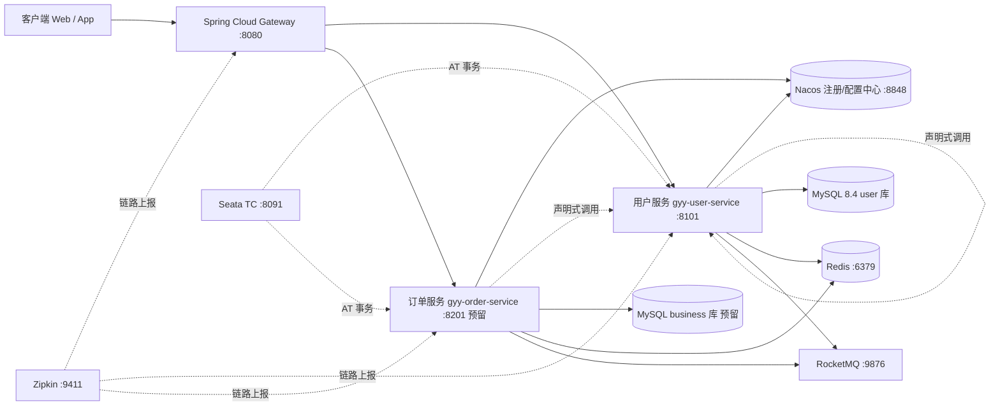

# 01 - 分布式架构设计

## 1. 总体架构



## 2. 工程模块划分（Maven 多模块，单仓库）

```
gyy-backend/
├── pom.xml                    # 父 POM：统一依赖版本管理（dependencyManagement）
├── gyy-common/                # 通用包：Result、异常、工具、常量（无业务）
├── gyy-api/                   # Feign 接口 + DTO，供服务间引用
├── gyy-gateway/               # 网关：路由、全局鉴权、限流、跨域
└── gyy-services/
    ├── gyy-user-service/      # 用户服务（首个落地服务，连 user 库）
    └── gyy-order-service/     # 订单服务（预留示例，说明拆分方式）
```

> **拆分原则**：按业务能力拆（用户、订单……），不按技术层拆；一个服务一个数据库 Schema，禁止跨服务直连别人的库——跨库访问一律走 Feign 或 MQ。

## 3. 服务清单与端口规划

| 服务 | 模块 | 端口 | 职责 | 数据库 |
| --- | --- | --- | --- | --- |
| 网关 | gyy-gateway | 8080 | 路由、JWT 鉴权、限流、日志 | 无 |
| 用户服务 | gyy-user-service | 8101 | 用户 CRUD、头像上传 | `user`（表 `user_db`） |
| 订单服务（预留） | gyy-order-service | 8201 | 订单 | `business`（待建） |
| Nacos | 基础设施 | 8848 / 9848 | 注册中心 + 配置中心 | 内嵌 derby/外接 MySQL |
| Redis | 基础设施 | 6379 | 缓存、分布式锁 | — |
| RocketMQ Namesrv/Broker | 基础设施 | 9876 / 10911 | 消息 | — |
| Seata TC | 基础设施 | 8091 | 全局事务协调 | seata 库 |
| Zipkin | 基础设施 | 9411 | 链路查询 | 内存/es |

## 4. 关键机制

### 4.1 注册与配置（Nacos）

- 所有服务启动即注册到 Nacos，`spring.cloud.nacos.discovery.server-addr=${NACOS_ADDR:127.0.0.1:8848}`。
- **配置一律进 Nacos**（`gyy-user-service-dev.yaml`），本地只保留 bootstrap 级别的连接信息；`application-local.yml` 仅放本机密码类配置且不入库。

### 4.2 服务间调用（OpenFeign）

```java
@FeignClient(name = "gyy-user-service", path = "/api/v1/users")
public interface UserClient {
    @GetMapping("/{userId}")
    Result<UserDTO> getUser(@PathVariable("userId") Long userId);
}
```

- 超时：connect 2s / read 5s，重试次数 1（只对 GET 重试）。
- 调用方**必须**处理 `Result.code != 0`，禁止裸抛。

### 4.3 分布式事务

| 场景 | 方案 |
| --- | --- |
| 强一致（下单扣库存） | Seata **AT 模式**，各服务库建 `undo_log` 表 |
| 允许秒级延迟（发通知、积分） | RocketMQ **事务消息 / 最终一致**，消费端幂等（唯一键 + 去重表） |
| 只读/单库 | 不加事务注解，避免无谓的全局锁 |

### 4.4 鉴权与安全

- 网关统一校验 JWT（`jjwt`），透传 `X-User-Id` / `X-Trace-Id` 给下游。
- 服务间调用走内网 + 网关白名单；生产环境服务间加 mTLS 或内部签名（后续迭代）。

### 4.5 可观测性

- 日志：Logback JSON 格式，`traceId` 由 Micrometer Tracing 自动注入 MDC。
- 指标：`spring-boot-actuator` + Prometheus 端点。
- 慢 SQL：MySQL 侧开 `slow_query_log`，应用侧 MyBatis-Plus `PerformanceInterceptor`（dev 环境）。

## 5. 环境规划

| 环境 | 基础设施 | 配置文件 | 说明 |
| --- | --- | --- | --- |
| dev | 本机 Docker Compose 一键起 Nacos/Redis/MQ | `application-local.yml`（gitignore） | 本机 MySQL 8.4.13（Windows 服务 MySQL84） |
| test | 测试服务器 | Nacos `test` 命名空间 | 自动化回归 + Apifox 测试 |
| prod | K8s | Nacos `prod` 命名空间 | 密码走 K8s Secret |

## 6. 部署

开发环境 `docker-compose.yml`（示例骨架）：

```yaml
services:
  nacos:
    image: nacos/nacos-server:v2.4.3
    ports: ["8848:8848", "9848:9848"]
    environment:
      MODE: standalone
  redis:
    image: redis:7-alpine
    ports: ["6379:6379"]
  zipkin:
    image: openzipkin/zipkin
    ports: ["9411:9410"]
```

> MySQL **不进容器**：直接使用本机已安装的 MySQL84 服务（8.4.13），详见 [03-MySQL连接配置](./03-MySQL连接配置.md)。
