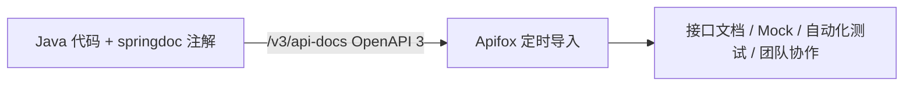
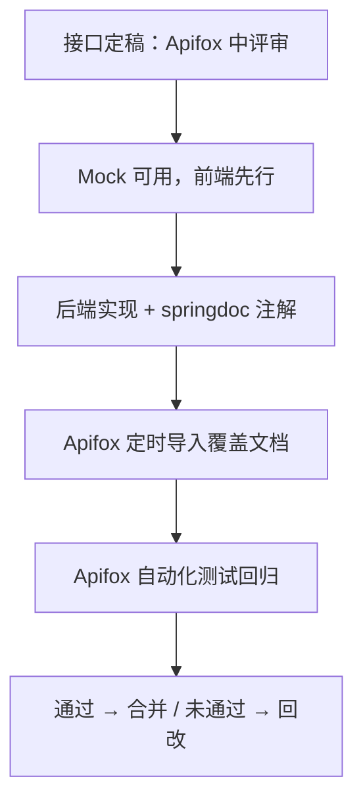

# 02 - 接口规范与 Apifox 集成

## 1. RESTful 设计规范

| 动作 | 方法 | 路径 | 说明 |
| --- | --- | --- | --- |
| 分页查询 | GET | `/api/v1/users?pageNum=1&pageSize=10` | 列表一律分页 |
| 详情 | GET | `/api/v1/users/{userId}` | — |
| 新增 | POST | `/api/v1/users` | Body = JSON |
| 全量更新 | PUT | `/api/v1/users/{userId}` | — |
| 删除 | DELETE | `/api/v1/users/{userId}` | 走逻辑删除 `is_deleted` |
| 上传头像 | POST | `/api/v1/users/{userId}/avatar` | `multipart/form-data` |

**硬性规则**

1. 路径小写、复数名词、不带动词（动作语义由 HTTP 方法表达）。
2. 资源 ID 用业务主键（如 `userId`），不暴露数据库自增值给外部系统时可另行设计。
3. 状态语义用 HTTP 状态码 + 业务码双层表达（见 1.2）。
4. 接口路径带版本 `/api/v1`；破坏性变更升 `/api/v2`，旧版本保留一个迭代周期。

### 1.1 统一响应体 `Result<T>`（定义在 gyy-common）

```java
public record Result<T>(int code, String message, T data, String traceId) {
    public static <T> Result<T> ok(T data)  { return new Result<>(0, "success", data, TraceContext.traceId()); }
    public static Result<Void> fail(ErrorCode ec) { return new Result<>(ec.getCode(), ec.getMessage(), null, TraceContext.traceId()); }
}
```

| code | 含义 |
| --- | --- |
| 0 | 成功 |
| 4xx00 | 客户端参数类错误（40001 参数缺失、40002 格式错误…） |
| 40100 | 未登录 / token 无效 |
| 40300 | 无权限 |
| 40400 | 资源不存在 |
| 5xx00 | 服务端错误（50000 兜底、50001 下游超时…） |

### 1.2 分页规范

```json
{
  "code": 0, "message": "success",
  "data": { "pageNum": 1, "pageSize": 10, "total": 233, "records": [ { } ] }
}
```

### 1.3 参数校验

Controller 上 `@Validated`，DTO 用 `@NotNull` / `@Size` / `@Positive`；`user_age` 0–150 在**数据库 CHECK**与应用层双保险。

### 1.4 全局异常处理

`@RestControllerAdvice` 统一兜底：`MethodArgumentNotValidException` → 40002；`BusinessException` → 对应业务码；未知异常 → 50000 且**只记日志不回显堆栈**。所有响应带 `traceId`，与 Zipkin 对齐。

## 2. Apifox 集成方案

**采用「代码即文档」：代码注解生成 OpenAPI，Apifox 自动同步，禁止手工双维护。**



### 2.1 代码侧（springdoc-openapi）

```xml
<dependency>
  <groupId>org.springdoc</groupId>
  <artifactId>springdoc-openapi-starter-webmvc-ui</artifactId>
  <version>2.8.x</version>
</dependency>
```

```java
@Tag(name = "用户管理", description = "user_db 表 CRUD")
@RestController
@RequestMapping("/api/v1/users")
public class UserController {

    @Operation(summary = "用户详情", description = "按 userId 查询，不存在返回 40400")
    @GetMapping("/{userId}")
    public Result<UserVO> detail(@PathVariable Long userId) { ... }
}
```

- 每个服务暴露 `http://localhost:{port}/v3/api-docs`（dev 环境开放，prod 关闭）。
- 网关聚合：springdoc 支持通过 Gateway 汇总各服务文档，Apifox 只需配一个聚合地址。

### 2.2 Apifox 侧配置

| 配置项 | 规范 |
| --- | --- |
| 项目结构 | 一个 Apifox 项目对应一个后端服务；目录 = Controller 名 |
| 数据同步 | 「导入数据 → OpenAPI/Swagger → URL 定时导入」，URL 填 `http://localhost:8101/v3/api-docs`，间隔 5 分钟 |
| 环境变量 | `baseUrl_dev=http://127.0.0.1:8080`（走网关）、`baseUrl_local=http://127.0.0.1:8101`（直连调试） |
| Mock | 依赖 Apifox 智能 Mock，前端在接口未实现前即可联调 |
| 自动化测试 | 核心接口（登录、用户 CRUD）必配用例，回归在 test 环境跑 |
| 凭据 | 测试账号、密码放 Apifox「环境变量-私密值」，禁止明文写进接口描述 |

### 2.3 首个落地接口清单（user_db）

| Apifox 目录 | 接口 | 对应文档 |
| --- | --- | --- |
| 用户管理 | GET /api/v1/users（分页） | §1 |
| 用户管理 | GET /api/v1/users/{userId} | §1 |
| 用户管理 | POST /api/v1/users | §1 |
| 用户管理 | PUT /api/v1/users/{userId} | §1 |
| 用户管理 | DELETE /api/v1/users/{userId} | §1（逻辑删除） |
| 用户管理 | POST /api/v1/users/{userId}/avatar | 图片二进制写 `user_img`(LONGBLOB)，单文件 ≤ 16 MB（见 03 文档 max_allowed_packet 说明） |

## 3. 联调流程



**规则**：接口变更必须先改 Apifox（评审通过）再改代码；「文档与实现不一致」按实现方缺陷处理。
